# SpreadFlow — визуальный разбор

> Это Markdown-версия разбора: диаграммы ниже отрисовываются в GitHub, GitLab, Obsidian или в VS Code Markdown Preview с поддержкой Mermaid.  
> Полный текстовый вариант без рендера лежит в `response.txt`.

---

## 0. Контекст и стек

SpreadFlow — клиентский SPA-терминал для арбитражных спредов MOEX. Реально работает только MOEX-контур: 11 пар «акция TQBR → фьючерс FORTS», 14 активов для календарных спредов, polling ISS каждые 15 секунд. Вся аналитика считается на клиенте. Бэкенда, БД, WebSocket, авторизации и алертов нет.

| Слой | Технологии |
|---|---|
| UI | React 19, React Router 7, CSS Modules |
| Состояние | TanStack Query 5, Zustand 5 |
| HTTP | Axios |
| Типы/валидация | TypeScript 6 strict, Zod 4 |
| Сборка | Vite 8, `@vitejs/plugin-react`, `vite-plugin-svgr` |
| Стили | CSS-переменные, CSS Modules, тёмная тема, Inter |
| Backend | Нет. README упоминает Node.js, PostgreSQL, Prisma, WebSocket — это цель, а не текущее состояние |

```bash
npm install
npm run dev      # http://localhost:3000
npm run build    # tsc -b && vite build
npm run lint
```

`vite.config.ts` поднимает dev-сервер на `3000` и проксирует `/api/moex` → `https://iss.moex.com/iss`. Proxy работает только в `dev`; в production нужен reverse proxy или смена `baseURL`. `.env`-файлов, тестов и CI нет.

---

## 1. Карта проекта: кто кого рендерит

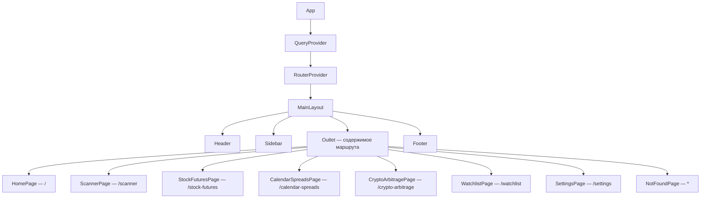

`MainLayout` — общий каркас: sticky-header, sidebar 240px, скроллящийся `main` с `Outlet` и footer. Все страницы — дети одного layout-маршрута `/`.

---

## 2. FSD-слои: как должно быть и как есть

### 2.1 Идеальное направление зависимостей

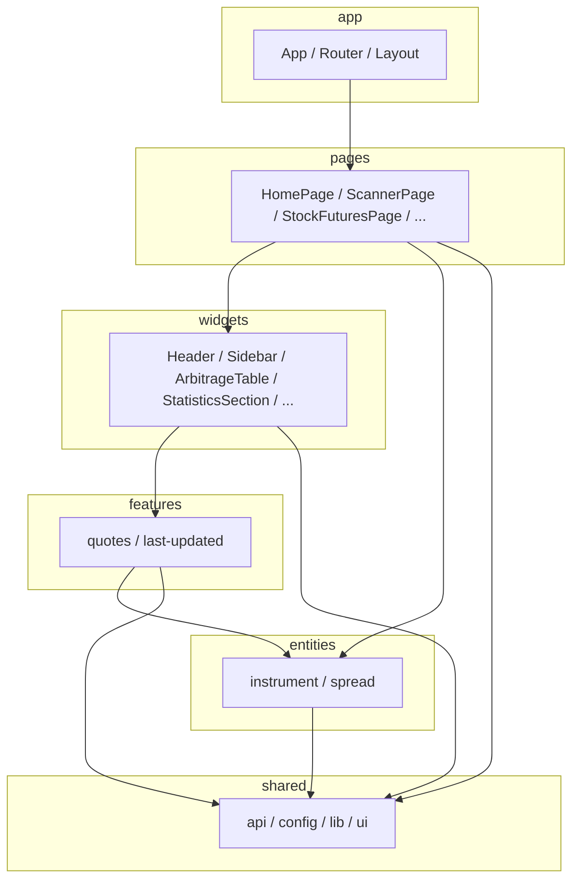

Правило: нижний слой не должен импортировать верхний. `shared` — фундамент, `app` — вершина.

### 2.2 Фактические нарушения

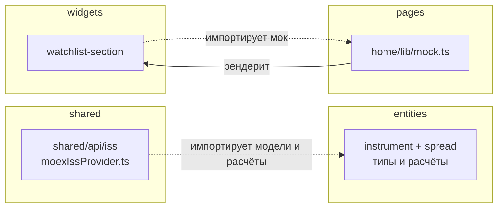

| Нарушение | Где | Почему плохо |
|---|---|---|
| `shared → entities` | `shared/api/iss/moexIssProvider.ts` | `shared` перестаёт быть независимым фундаментом; провайдер знает доменные типы и вызывает `buildCashAndCarrySignal` |
| `widgets → pages` | `widgets/watchlist-section` → `pages/home/lib/mock` | Архитектурный цикл `page → widget → page`; виджет нельзя переиспользовать без страницы |
| `pages → pages` | `pages/watchlist` → `pages/home/lib/mock` | Межстраничная зависимость и дублирование витрины watchlist |

Ещё мёртвый код: `HeroSection`, `NewsSection`, `HeatmapSection`, `shared/ui/Section`, `shared/ui/Container`, `arbitrageSignals` из мока.

---

## 3. Доменные модели

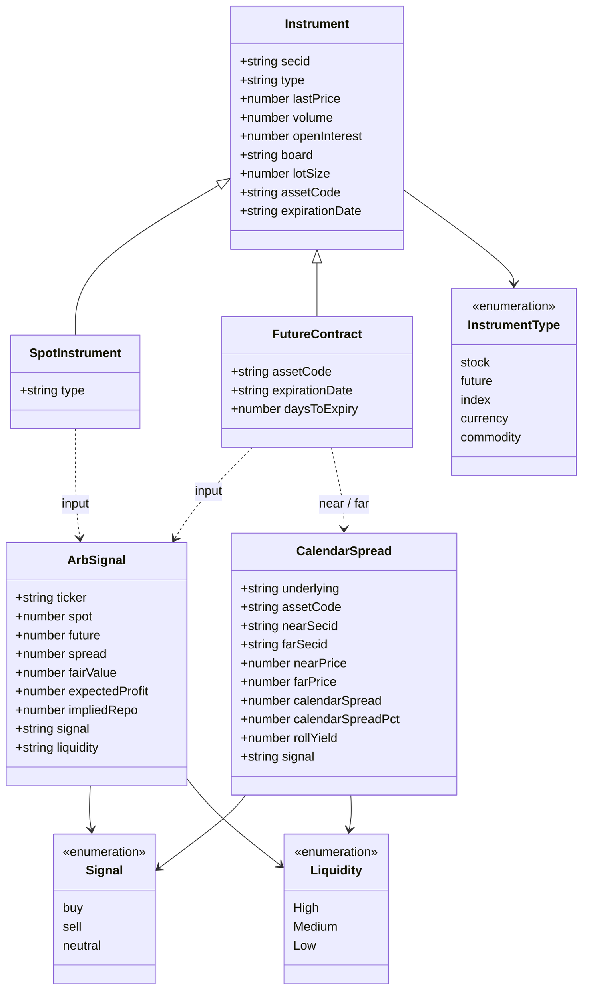

Схема концептуальная: `ArbSignal` и `CalendarSpread` не хранят внутри `Instrument` — они вычисляются из спот- и фьючерс-объектов.

Важно: Zod-схемы используются только как источник типов через `z.infer`. Runtime-валидации `.parse()` / `.safeParse()` в проекте нет.

### 3.1 Universe

`src/shared/config/moexUniverse.ts` — ручной список инструментов.

| Spot SECID | Asset code | Подпись |
|---|---|---|
| SBER | SBRF | Sberbank |
| GAZP | GAZR | Gazprom |
| LKOH | LKOH | Lukoil |
| GMKN | GMKN | Norilsk Nickel |
| ROSN | ROSN | Rosneft |
| NVTK | NOTKM | Novatek |
| TATN | TATN | Tatneft |
| MGNT | MGNT | Magnit |
| YDEX | YDEX | Yandex |
| OZON | OZON | Ozon Holdings |
| X5 | X5 | X5 Group |

`CALENDAR_SPREAD_UNIVERSE` = `Si / Si`, `RI / RTS`, `MX / MXI` + все 11 акций.

Последние три (`YDEX`, `OZON`, `X5`) добавлены в **незакоммиченных** изменениях: в коммите их ещё нет, но в рабочем дереве и на собранной странице они уже участвуют.

---

## 4. Поток данных — главное

### 4.1 Один взгляд: от MOEX ISS до таблицы

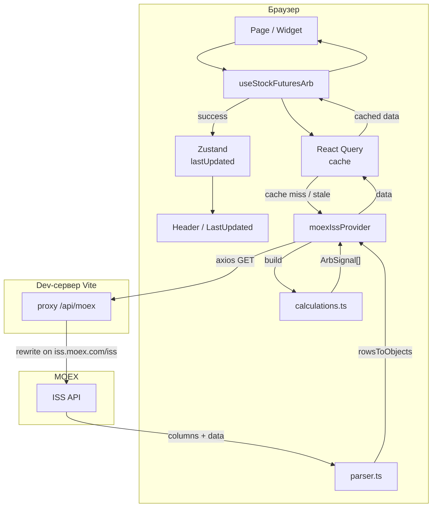

Ключевая мысль: **React Query не ходит в ISS напрямую**. Он вызывает `quoteProvider`, а тот внутри использует `apiClient`, парсер и доменные расчёты.

### 4.2 Stock/futures: кто кого вызывает

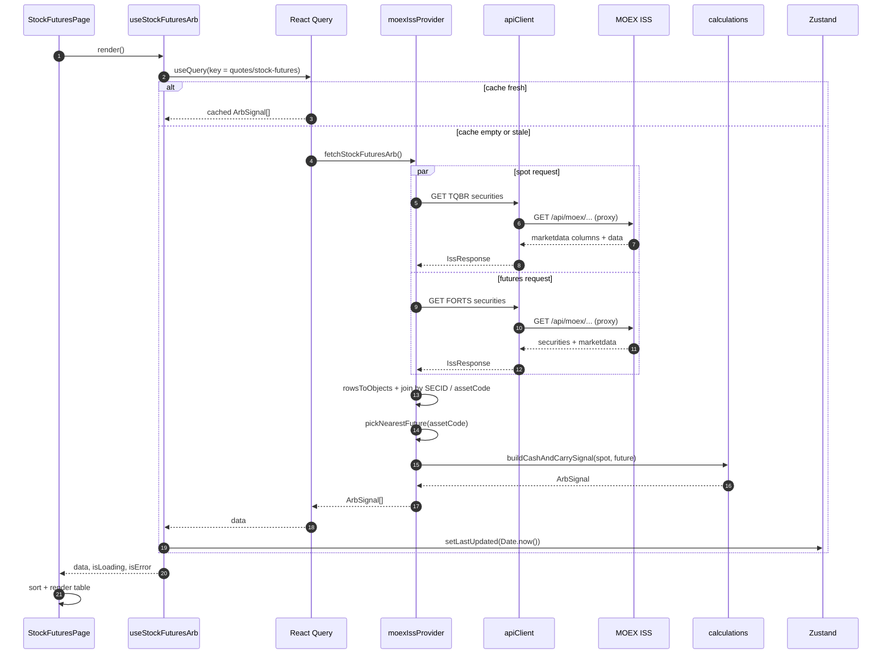

Два HTTP-запроса идут параллельно через `Promise.all`:

1. спот-цены TQBR по списку SECID;
2. все фьючерсы FORTS (потом фильтрация по `assetCode` в памяти).

### 4.3 Calendar spreads: вариант того же потока

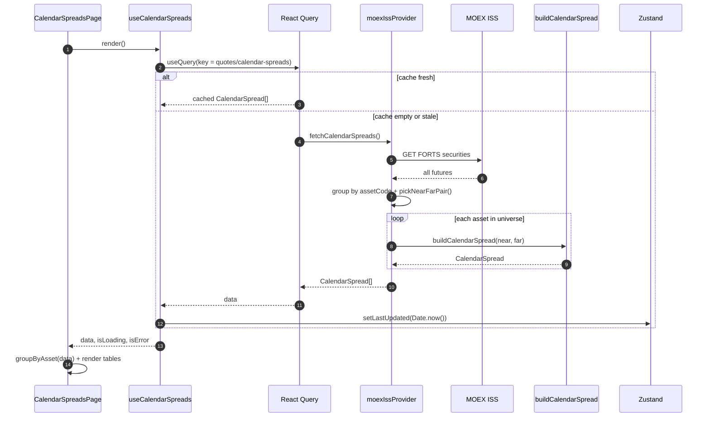

Отличие: спот-запрос не нужен, и на каждый актив считается одна пара near/far.

### 4.4 Жизненный цикл React Query

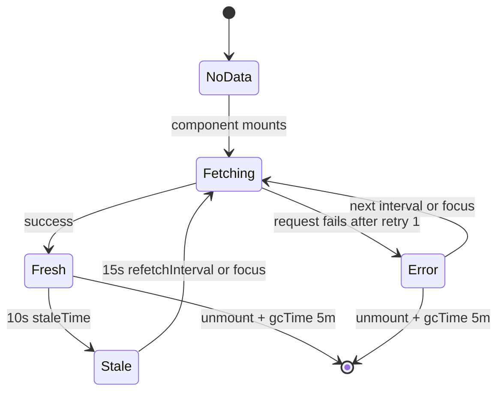

Параметры:

| Параметр | Значение |
|---|---|
| `retry` | `1` |
| `refetchOnWindowFocus` | `true` |
| `refetchInterval` | `15_000` мс |
| `staleTime` | `10_000` мс |
| `refetchIntervalInBackground` | `false` по умолчанию |
| `gcTime` | 5 минут по умолчанию |

### 4.5 Одна строка насквозь: SBER / SRZ6

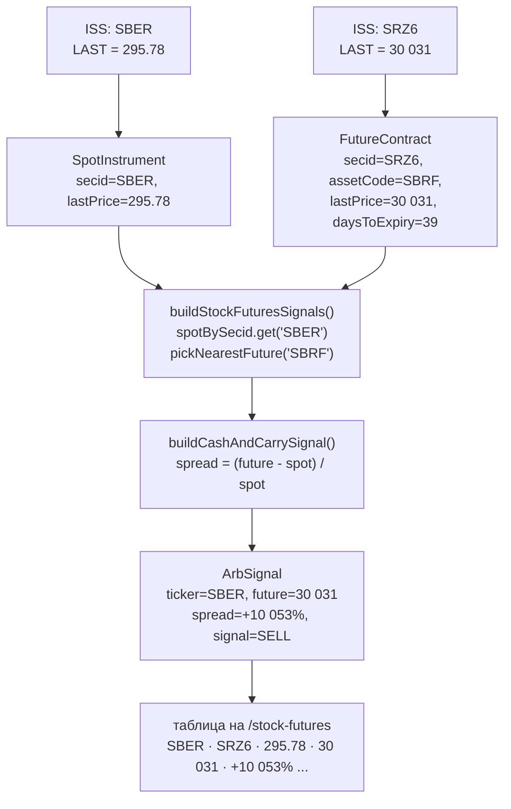

Именно в этом месте виден P0-баг: `spot` — за акцию, `future` — за контракт. После нормализации на `LOTVOLUME=100` спред становится `+1.53%`, а сигнал — `NEUTRAL`. Подробнее в разделе 5.

### 4.6 Кто за что отвечает

| Компонент | Файл | Вход | Выход |
|---|---|---|---|
| Хук stock | `features/quotes/model/useQuotes.ts` | render компонента | `data`, `isLoading`, `isError` |
| Хук calendar | `features/quotes/model/useQuotes.ts` | render компонента | `data`, `isLoading`, `isError` |
| Провайдер | `shared/api/iss/moexIssProvider.ts` | `QuoteProvider`-вызов | `ArbSignal[]` / `CalendarSpread[]` |
| HTTP-клиент | `shared/api/client.ts` | путь + params | `IssResponse` |
| Парсер | `shared/api/iss/parser.ts` | `columns + data` | объекты, числа, даты |
| Расчёты | `entities/spread/lib/calculations.ts` | спот + фьючерс | `ArbSignal` / `CalendarSpread` |
| Мета-стор | `shared/lib/quotesMetaStore.ts` | timestamp | `lastUpdated` для header |

### 4.7 Короткое резюме

1. Компонент вызывает хук.
2. Хук спрашивает React Query по ключу `quotes/stock-futures` или `quotes/calendar-spreads`.
3. При cache miss/stale React Query вызывает `moexIssProvider`.
4. Провайдер делает запросы через `apiClient` → Vite proxy → MOEX ISS.
5. Парсер превращает колоночный JSON в объекты.
6. Провайдер выбирает контракты и вызывает чистые функции расчёта.
7. React Query кэширует результат.
8. Хук обновляет `lastUpdated` в Zustand.
9. Компонент рендерит таблицу/карточки; header показывает «Updated N secs ago».

---

## 5. Финансовая логика и P0-баг

### 5.1 Формулы

```text
fairValue      = spot * (1 + repoRate * daysToExpiry / 365)
spreadPct      = (future - spot) / spot * 100
expectedProfit = (fairValue - future) / spot * 100
impliedRepo    = (future / spot - 1) * (365 / daysToExpiry) * 100
```

```text
expectedProfit > +0.25%  → buy
expectedProfit < -0.25%  → sell
иначе                    → neutral
```

Календарный спред:

```text
calendarSpread    = farPrice - nearPrice
calendarSpreadPct = calendarSpread / nearPrice * 100
daysBetween       = max(1, far.daysToExpiry - near.daysToExpiry)
rollYield         = (farPrice / nearPrice - 1) * (365 / daysBetween) * 100
expectedProfit    = -calendarSpreadPct
```

### 5.2 Почему сейчас получаются тысячи процентов

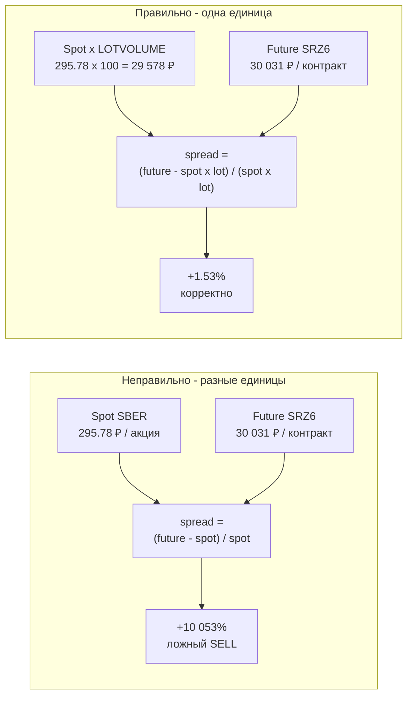

### 5.3 Две причины бага

1. В `fetchFortsSecurities` запрашивается колонка `LOTSIZE`, но в FORTS-таблице она называется `LOTVOLUME`. ISS молча игнорирует неизвестное поле, поэтому `lotSize` всегда `undefined`.
2. Даже если бы `lotSize` приходил, `calculations.ts` его не использует — сравнивает `spot` и `future` напрямую.

### 5.4 Живые значения на 09.11.2026

| Пара | Spot, ₽/акция | Future, ₽/контракт | `LOTVOLUME` | Future на акцию | Spread в коде | Корректный spread |
|---|---:|---:|---:|---:|---:|---:|
| SBER / SRZ6 | 295.78 | 30 031 | 100 | 300.31 | **+10 053%** | +1.53% |
| GAZP / GZZ6 | 114.19 | 11 589 | 100 | 115.89 | **+10 049%** | +1.49% |
| LKOH / LKZ6 | 6 037 | 56 590 | 10 | 5 659 | **+837%** | −6.26% |
| X5 / X5Z6 | 2 341 | 2 202 | 1 | 2 202 | −5.94% | −5.94% |

Следствия: сканер показывает 7 ложных `SELL`, а главная — «Average Spread» и «Largest Spread» в тысячах процентов.

### 5.5 Как исправить

```ts
// provider
'securities.columns':
  'SECID,SHORTNAME,ASSETCODE,LASTDELDATE,LOTVOLUME,MINSTEP'

lotSize: parseNumber(row.LOTVOLUME) ?? undefined
```

```ts
// calculations
const lot = futureContract.lotSize
const spotPerContract = spot * lot

const fairValue =
  spotPerContract * (1 + repoRate * daysToExpiry / 365)

const spreadPct =
  ((future - spotPerContract) / spotPerContract) * 100

const expectedProfit =
  ((fairValue - future) / spotPerContract) * 100

const impliedRepo =
  (future / spotPerContract - 1) * (365 / daysToExpiry) * 100
```

`lotSize ?? 1` лучше не использовать: если поле снова не придёт, баг вернётся молча. Лучше сделать `lotSize` обязательным для `FutureContract`.

### 5.6 Другие ограничения модели

- нет дивидендов: `F = (S - PV(D)) * (1 + rT)`, а не `S * (1 + rT)`;
- нет комиссий, налогов, маржи, borrow и проскальзывания;
- порог `0.25%` может быть ниже реальных издержек;
- нет проверки торговой сессии;
- `LAST` — последняя сделка, а не расчётная цена;
- DTE считается по `LASTDELDATE`, а не по `LASTTRADEDATE`;
- `daysUntil` зависит от таймзоны;
- `pickNearestFuture` / `pickNearFarPair` не пропускают контракты без цены;
- ставка репо в коде `14.25%`, а в Settings написано `16%`;
- сортировка по Ticker не работает: `Number('SBER')` даёт `NaN`.

---

## 6. Маршруты и экраны

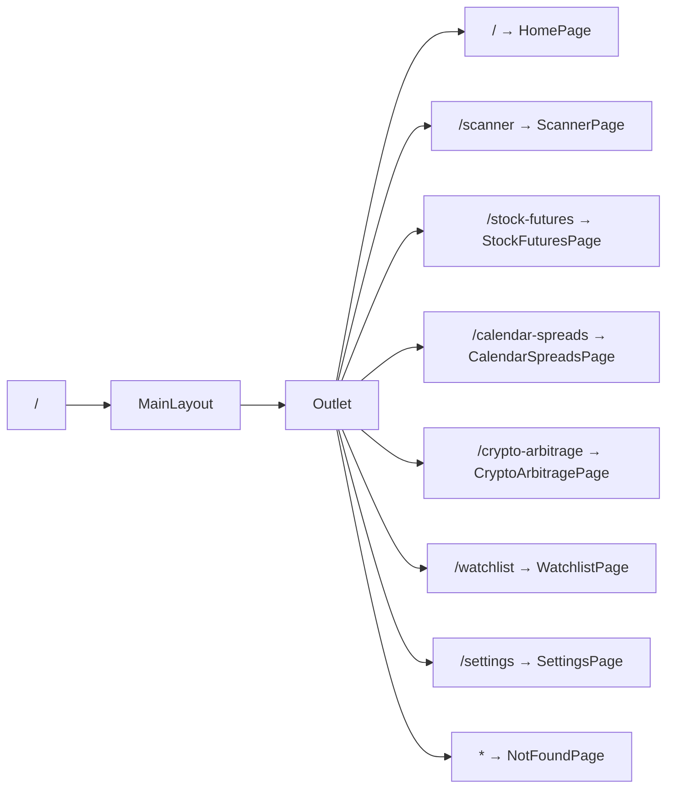

| URL | Данные | Статус |
|---|---|---|
| `/` | `StatisticsSection` + `ArbitrageTable` — реальный stock-запрос; `MarketOverview` + `WatchlistSection` — моки | Частично |
| `/scanner` | реальный stock-запрос, фильтр `signal !== 'neutral'` | Работает, но P0-баг лотов |
| `/stock-futures` | реальный stock-запрос | Работает, но P0-баг лотов |
| `/calendar-spreads` | реальный calendar-запрос | Работает, эвристические сигналы |
| `/crypto-arbitrage` | нет | Заглушка |
| `/watchlist` | мок | Только UI |
| `/settings` | статический текст | Только UI |
| `*` | нет | 404 |

---

## 7. Статус и roadmap

### 7.1 История

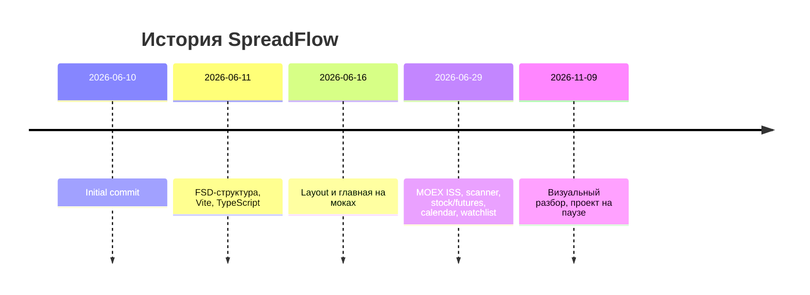

### 7.2 Что реально готово

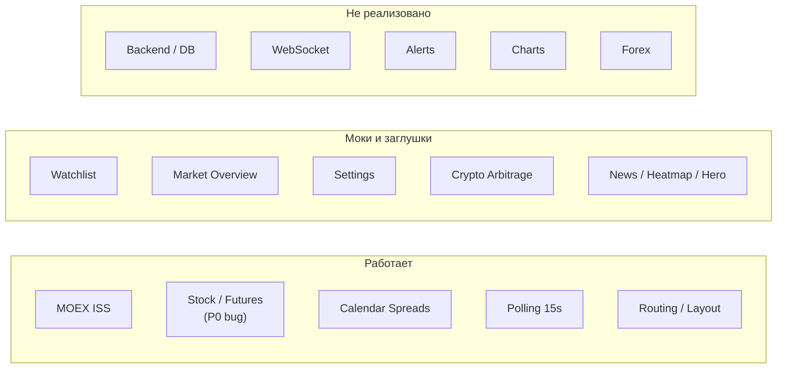

### 7.3 Ветки и рабочее дерево

- `develop` — текущая ветка, совпадает с `origin/develop`.
- `origin/main` содержит дополнительные merge-коммиты PR #8–#10, но дерево файлов **идентично** `develop`: `git diff develop origin/main` пустой. История разная, содержимое одинаковое.
- Локальный `main` указывает на самый первый коммит. Если переключиться на него, можно увидеть почти пустой проект; актуальная история — в `origin/main`.
- `feature/theme` не содержит уникальных коммитов — тема не делалась.
- Последний коммит — `2026-06-29 11:19 +0300`; проект стоит около 4,3 месяцев.

В рабочем дереве 5 изменённых файлов:

- `src/shared/config/moexUniverse.ts` — добавлены `YDEX`, `OZON`, `X5`;
- `src/entities/spread/lib/calculations.ts` — форматирование и комментарии;
- `src/features/quotes/model/useQuotes.ts` — комментарий;
- `src/shared/api/iss/parser.ts` — форматирование;
- `src/widgets/statistics-section/ui/StatisticsSection.module.css` — padding.

Новых неотслеживаемых файлов нет, кроме созданных `response.txt` / `response.md`. Сборка с этими изменениями проходит. Перед переключением веток их стоит закоммитить или сохранить.

### 7.4 Приоритеты

**P0 — корректность**

1. Починить `LOTVOLUME` + нормализацию.
2. Добавить unit-тесты на формулы с фикстурами SBER/GAZP/LKOH/X5.
3. Синхронизировать ставку репо: `14.25%` в коде vs `16%` в Settings.

**P1 — настраиваемость и устойчивость**

4. Вынести `repoRate`, `signalThreshold`, polling interval в конфиг/Zustand.
5. Включить runtime-валидацию Zod на границе ISS.
6. Обрабатывать отсутствующие цены и использовать `PREVSETTLEPRICE` как fallback.
7. Учитывать дивиденды/комиссии или явно писать, что модель упрощённая.
8. Показывать биржевой timestamp (`UPDATETIME`), а не только время клиентского запроса.

**P2 — продукт**

9. Persist watchlist + добавление/удаление.
10. Настоящие настройки: форма, сохранение, влияние на расчёты.
11. Backend: Node/Postgres/Prisma/WebSocket, серверный polling и кэш, алерты.
12. Production proxy на `/api/moex` или смена `baseURL`.
13. Общий интерфейс провайдера для crypto/forex.

**P3 — качество**

14. Убрать мёртвый код и неиспользуемые ассеты.
15. Исправить FSD-инверсии (`shared → entities`, `widgets → pages`).
16. Починить сортировку по Ticker.
17. Lazy-load роутов, сжать логотип, убрать неиспользуемые зависимости.
18. Добавить CI, ESLint в pipeline, тесты.

---

## 8. Что читать в коде

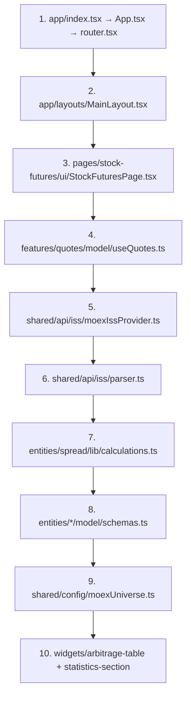

---

## 9. Что проверено

- `npm run build` — успешно, 271 модуль, без ошибок TypeScript.
- Dev-сервер и браузер:
  - `/stock-futures` — 11 строк;
  - `/calendar-spreads` — 14 групп;
  - `/scanner` — 9 активных карточек;
  - `LastUpdated` в header тикает.
- MOEX ISS подтвердил:
  - поле называется `LOTVOLUME`, а не `LOTSIZE`;
  - `LOTVOLUME`: SRZ6 — 100, GZZ6 — 100, LKZ6 — 10, X5Z6 — 1.
- `npm run lint` в этой сессии не завершился за 180 секунд — отдельно не подтверждён.
- Все 14 Mermaid-блоков из `response.md` успешно отрендерены Mermaid 11 в браузере.
